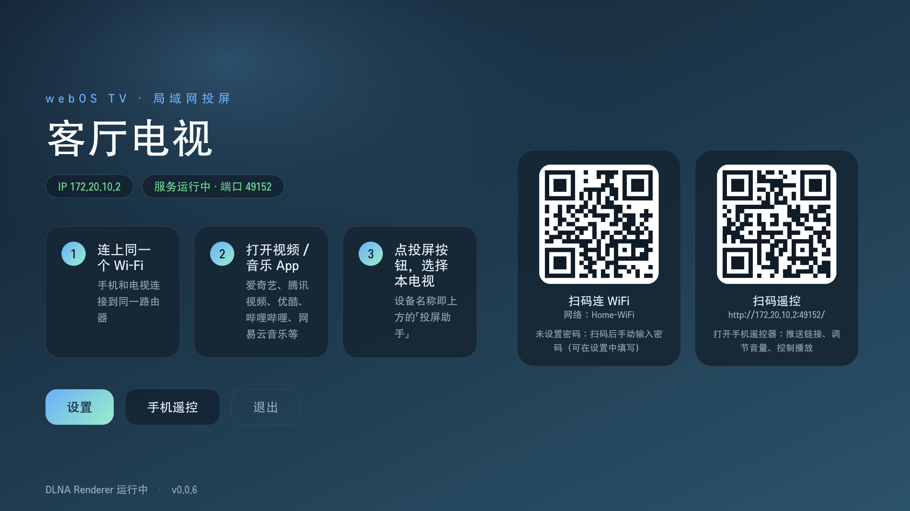
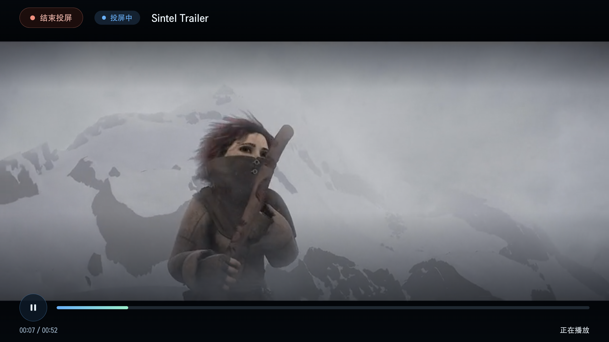
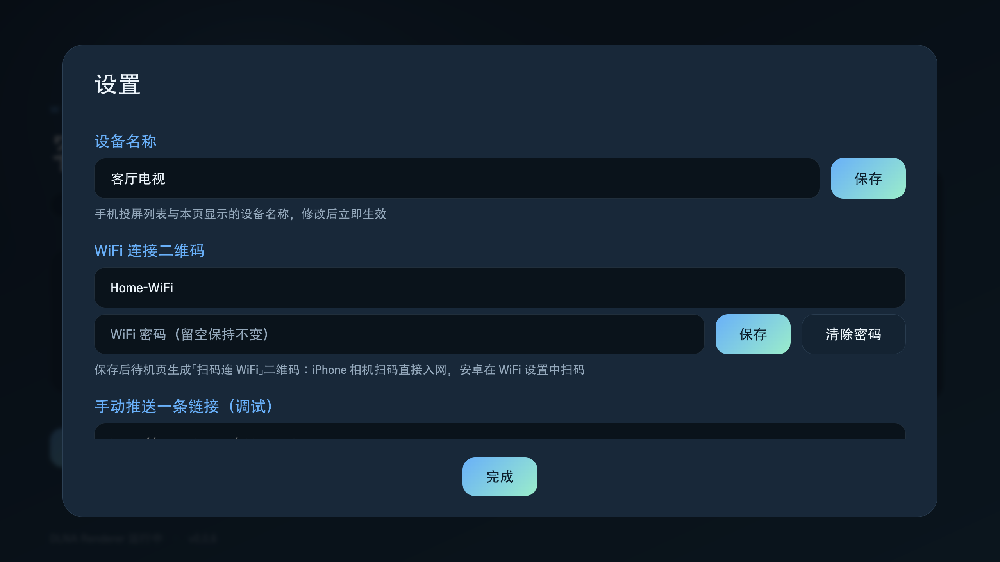

# Cast Receiver for webOS TV (投屏助手)

[简体中文](README.md) · **English**

An open-source LAN casting receiver for **LG webOS TVs** (including Chinese-market models): video / music / photo apps on your phone cast content to the TV over the standard **DLNA / UPnP** protocol, with a mobile web remote, a scan-to-join-WiFi QR code, and an on-TV settings panel.

Pure JavaScript (a webOS web app + a background JS service). No root required, no system components modified.

- **DLNA Renderer**: a complete UPnP MediaRenderer implementation (SSDP discovery + SOAP control + GENA eventing)
- **Mobile remote**: the TV idle page shows a QR code — scan it to control playback, push links, and adjust volume from your phone
- **Scan to join WiFi**: the idle page also shows a WiFi-join QR code that works on both iPhone and Android
- **AirPlay**: not supported out of the box on Chinese-market models; the app probes and tells you explicitly (see [AirPlay support](#airplay-support))

## Table of contents

- [Screenshots](#screenshots)
- [Features](#features)
- [Requirements & compatibility](#requirements--compatibility)
- [How it works](#how-it-works)
- [Project layout](#project-layout)
- [Installation](#installation)
- [Development guide](#development-guide)
- [API reference](#api-reference)
- [Known limitations](#known-limitations)
- [FAQ](#faq)
- [AirPlay support](#airplay-support)
- [Contributing](#contributing)
- [License](#license)
- [References](#references)

## Screenshots

| Idle page (dual QR) | Playback controls | Settings |
| --- | --- | --- |
|  |  |  |

## Features

### Casting playback (DLNA / UPnP MediaRenderer)

- **Device discovery**
  - Answers `M-SEARCH` probes: `ssdp:all` / `upnp:rootdevice` / `uuid:` / device & service type queries, with random MX delay and duplicated responses
  - Periodic `NOTIFY ssdp:alive` heartbeat (every 30 s) plus `ssdp:byebye` on exit; re-announces automatically when the IP changes
  - When udp/1900 is held by the TV's built-in DLNA stack, it degrades to an announce-only mode and says so on the idle page
- **Full AVTransport control**: `SetAVTransportURI`, `SetNextAVTransportURI`, `Play`, `Pause`, `Stop`, `Seek`, `Next`, `Previous`, `SetPlayMode`, `GetTransportInfo`, `GetPositionInfo`, `GetMediaInfo`, `GetDeviceCapabilities`, `GetTransportSettings`, `GetCurrentTransportActions`, `GetSearchCapabilities`, `GetSortCapabilities`
- **RenderingControl**: `GetVolume` / `SetVolume` / `GetMute` / `SetMute` / `ListPresets` / `SelectPreset`
- **ConnectionManager**: `GetProtocolInfo` / `GetCurrentConnectionIDs` / `GetCurrentConnectionInfo`
- **GENA eventing**: `SUBSCRIBE` / `UNSUBSCRIBE` / `NOTIFY`, a full LastChange variable set, initial notifications, and automatic cleanup of expired subscriptions
- **Playback queue**: items cast consecutively from a phone app are queued automatically (capped at 200); supports bulk queue push, click-to-jump, next/previous
- **Play modes**: normal / repeat all / repeat one / shuffle, kept in sync both ways with the phone app
- **Subtitles**: SRT / VTT pushed by the app are converted and loaded automatically; a built-in subtitle proxy (`/proxy`) works around cross-origin restrictions
- **Error reporting**: playback failures are reported back as `TransportStatus=ERROR` so phone apps notice immediately; network errors are retried once
- **Resilience**: recovers from malformed requests (e.g. DIDL stuffed into the URI field), skips occupied HTTP ports automatically

### Full-screen player (TV side)

- **Three presentation modes**: video (full screen) / music (cover art + title + progress) / photo (full screen)
- **Progress-bar control**:
  - TV remote: D-pad ←/→ skips ±10 s, media keys ⏪/⏩ skip ±30 s
  - Magic-remote pointer (or mouse): click anywhere on the bar to seek precisely
- **End cast**: a persistent "End cast" button at the top-left during playback clears the queue and returns to the idle page
- **Exit protection**: the back key must be pressed twice to leave the app, so casting isn't interrupted by accident
- **System volume**: adjusts the TV's real system volume over Luna (`luna://com.webos.audio`); volume-key changes on the TV remote are also reported back to the phone app in real time

### Mobile web remote

Scan the QR code on the TV idle page (`http://<TV-IP>:49153/`) — no app install needed:

- Play / pause / stop / previous / next
- Seek slider with time display
- Volume slider and mute
- Play-mode switching
- Paste a direct URL (video / music / photo) to push it to the TV
- Queue management (click an item to play it)
- Rename the TV, set the WiFi SSID/password for the join QR code
- Long-poll sync, automatic reconnect with an offline indicator

### Scan to join WiFi

The idle page shows a standard `WIFI:` QR code so guests can join the TV's LAN:

- **iPhone**: scan with the Camera app → an "Join Network" prompt appears → one tap to connect
- **Android**: Android 10+ recognizes it from Settings → WiFi → scan; many OEM camera apps also support it directly
- **Auto-detected SSID**: when the TV is on wireless, the current SSID is read automatically (refreshed every 60 s); enter it manually if the TV is wired
- **Chinese-friendly**: QR payloads are UTF-8 encoded (fixing the library's default Latin-1 encoding that garbles Chinese), and SSID/password special characters are escaped per the spec (`\ ; , : "`)
- **Password safety**: the OS never exposes saved WiFi passwords, so the password is entered once via the TV panel or the web remote; it is stored locally on the TV and is **only returned over the Luna channel (local apps)** for drawing the QR — the LAN-facing HTTP API only exposes a `hasPassword` flag, never the password itself

### Settings panel (TV side)

Opened via the "Settings" button on the idle page, fully usable with the TV remote:

| Setting | Description |
| --- | --- |
| Device name | The name shown in phone casting lists; defaults to the detected TV model (e.g. "LG OLED77C5PCA"), editable, empty save restores the default |
| WiFi join QR | SSID (auto-detected, editable) + password; the idle-page QR updates immediately after saving |
| Manual push (debug) | Enter a media URL and play it on the TV directly |
| Help | Common troubleshooting (device not found, supported formats, …) |
| About | App info and the AirPlay probe result |

### Performance & stability

- The idle page uses a static CSS background (no animated gradients, no backdrop blur) and the long poll only pushes on state changes
- Measured on LG OLED77C5PCA (webOS 10.3.1, idle page):

  | Metric | Before | After |
  | --- | --- | --- |
  | Idle CPU | 99.2% | ~0.3% |
  | Memory RSS | 671 MB | 47 MB |

## Requirements & compatibility

- **TV**: LG webOS TV (Chinese-market or international), tested on webOS 10.3.1; code targets webOS 4.x+ (ES5 syntax, Node 0.12+ APIs)
- **Developer Mode enabled on the TV** (required to install)
- **Phone**: on the same LAN as the TV; any DLNA-capable app (iQIYI, Tencent Video, Youku, Bilibili, NetEase Cloud Music, …), or just use the web remote
- **Supported media formats** (limited by the webOS built-in browser engine):
  - Video: MP4 (H.264/H.265), HLS (m3u8), MKV, TS
  - Audio: MP3, AAC, FLAC, WAV, OGG
  - Photo: JPG, PNG, GIF, BMP, WebP
  - Subtitles: SRT / VTT

## How it works

```
phone cast app ──SOAP(AVTransport/RenderingControl)──► JS service ◄──long-poll /status── TV front-end
                 │                                    │
                 └──SSDP discovery + GENA events──────┘      TV front-end sets system volume via Luna
```

1. The background JS service starts and probes for the first free HTTP port from `49152` (on Chinese-market models 49152 is held by the TV's own DLNA stack; in practice it binds **49153**)
2. It joins the SSDP multicast (239.255.255.250:1900) and announces itself; phone apps discover it via `M-SEARCH`
3. The phone app fetches `device-description.xml`, then sends SOAP actions such as `SetAVTransportURI` → `Play`
4. The TV front-end observes changes through a `/status` long poll (millisecond-level) and loads media into `<video>/`
5. The front-end reports playback progress every second, so controllers/apps update in real time

## Project layout

```
├── README.md                       # Chinese docs
├── README.en.md                    # English docs
├── LICENSE                         # MIT license
├── app/                            # webOS app directory
│   ├── appinfo.json                # App metadata (version, …)
│   ├── index.html / styles.css / app.js  # TV front-end (idle page + player + settings + HUD)
│   ├── qr.js                       # Bundled QR code library (MIT, Kazuhiko Arase)
│   └── icon.png / largeIcon.png / bgImage.png  # App icons (script-generated)
├── packageinfo.json                # Combined package info (app + service)
├── scripts/
│   ├── gen-assets.js               # Icon generator (node scripts/gen-assets.js)
│   ├── bump-version.js             # One-command version bump (see Development guide)
│   └── controller-simulator.js     # Phone-cast simulator (local end-to-end test)
├── dist/                           # ares-package build output
├── docs/AIRPLAY_BRIDGE.md          # AirPlay bridge plan (root + UxPlay)
└── services/com.castreceiver.tv.service/
    ├── service.js                  # Background service (SSDP + UPnP + HTTP + Luna)
    ├── remote.html                 # Mobile web remote (served by the service)
    ├── services.json               # Luna service declaration
    └── package.json                # Service metadata
```

## Installation

### End users (via Developer Mode)

1. On the TV, open the "Developer Mode" app → sign in with an LG account → enable Dev Mode (keep it on)
2. Install the official CLI on your computer and register the TV:

   ```bash
   npm install -g @webos-tools/cli
   # Replace the IP with your TV's LAN IP; recent webOS builds use SSH port 9922
   # The key is the SSH key generated by Developer Mode (passphrase = the 6-digit Dev Mode code)
   ares-setup-device --add tv --host 192.168.1.23 --port 9922 --username prisoner --privatekey ~/.ssh/webos_dev_key
   ```

3. Clone this repository, then build and install:

   ```bash
   ares-package ./app ./services/com.castreceiver.tv.service -o dist
   ares-install --device tv ./dist/com.castreceiver.tv_<version>_all.ipk
   ares-launch --device tv com.castreceiver.tv
   ```

4. Open "Cast Receiver" (投屏助手) and keep it in the foreground: tap the cast button in your phone app and pick this TV, or scan the idle-page QR code for the web remote

> After updating, you must **fully close and relaunch the app** (webOS caches running web apps) — see [Known limitations](#known-limitations).

## Development guide

### Environment

- Node.js (any recent version; the `ares-*` toolchain installs via npm)
- For on-device debugging, enable Developer Mode and run `ares-setup-device`

### Local testing (no TV needed)

**webOS TV Simulator (GUI)**

1. Download a webOS TV Simulator from the LG Developer site
2. "Open App" → select this project's `app/` directory (any directory containing appinfo.json)
3. "Open Service" → select `services/com.castreceiver.tv.service/`
4. The simulator auto-installs the `webos-service` shim so the JS service runs on the desktop

**CLI + cast simulator**

```bash
# 1. Start the background service (needs the webos-service module or a shim)
cd services/com.castreceiver.tv.service
node service.js

# 2. Preview the TV UI by opening app/index.html in a browser

# 3. Run the cast simulator (SSDP discovery → device description → cast → play → volume → pause → photo)
node scripts/controller-simulator.js [TV IP]
```

### Code conventions

- Code and comments in **English**; UI strings in **Chinese** (`index.html` / `remote.html` / toasts)
- The service must run on old webOS engines: **ES5 syntax only**, avoid modern Node APIs
- Two `DEBUG` flags (top of `app.js` / `service.js`) default to `true`; flip to `false` for quiet production builds

### Version management

The version lives in 6 places (two JSON metadata files, the `VERSION` constant in `service.js`, the `app.js` footer, the static footer in `index.html`). After any change run:

```bash
node scripts/bump-version.js 0.0.2
```

### Regenerating icon assets

```bash
node scripts/gen-assets.js
```

### Debug logging

Both the app and the service ship in **DEBUG mode**, emitting categorized logs:

- Service: `[ssdp]` (discovery/M-SEARCH), `[soap]` (controller commands), `[gena]` (subscriptions/notifications), `[state]` (state machine), `[api]` (front-end control API), `[airplay]` (capability probe), `[boot]` (startup/config)
- Front-end: `[boot]` (service discovery), `[media]` (media loading), `[transport]` (play/pause sync), `[seek]`, `[volume]`, `[player]` (real player events), `[remote]` (TV remote keys), `[poll]`

```bash
# Front-end console (with DevTools)
ares-inspect --device tv com.castreceiver.tv

# Service logs (via syslog; also visible in Developer Mode → Log Viewer)
ares-inspect --device tv --service com.castreceiver.tv.service
```

## API reference

### HTTP (LAN; used by the front-end, the web remote, and debugging)

| Method | Path | Description |
| --- | --- | --- |
| GET | `/status` (optional `?rev=N&wait=15` long poll, `?light=1` slim) | Full state (media/progress/volume/queue/WiFi/AirPlay) |
| GET | `/` | Mobile web remote |
| GET | `/device-description.xml`, `/scpd/*` | UPnP device & service descriptions |
| POST | `/upnp/control/*`, `/upnp/event/*` | SOAP control and GENA subscriptions |
| GET | `/proxy?url=…` | Subtitle proxy (SRT/VTT conversion) |
| GET | `/health` | Health check |
| POST | `/renderer/play` | Play a URL `{url, title?, mediaType?}` |
| POST | `/renderer/queue` | Replace the queue `{items:[…]}` |
| POST | `/renderer/jump` | Jump to queue item `{index}` |
| POST | `/renderer/next` / `/renderer/previous` | Next / previous |
| POST | `/renderer/stop` / `/renderer/seek` / `/renderer/state` | Stop / seek `{position}` seconds / report playback state |
| POST | `/renderer/volume` / `/renderer/mute` | Volume `{volume:0-100}` / mute `{mute}` |
| POST | `/renderer/repeat` | Play mode `{mode:NORMAL\|REPEAT_ALL\|REPEAT_ONE\|SHUFFLE}` |
| POST | `/renderer/device-name` | Device name `{name}` (empty string restores the default) |
| POST | `/renderer/wifi` | WiFi QR info `{ssid?, password?}` (`password:null` clears it) |
| POST/GET | `/renderer/airplay` | Trigger an AirPlay probe manually |

Every `/renderer/*` response is the latest full state (same shape as `/status`).

### Luna (`luna://com.castreceiver.tv.service/`, local apps only)

| Method | Description |
| --- | --- |
| `status` | Full state (subscribable) |
| `play` / `stop` / `next` / `previous` | Playback control `{url?}` |
| `volume` / `mute` | Volume and mute |
| `device-name` | Read/set the device name |
| `wifi` | Read the WiFi QR info (**the only channel that returns the password**, local apps only) |
| `airplay` | Trigger an AirPlay probe |

## Known limitations

Several webOS platform behaviors matter when iterating on real hardware:

1. **Fully relaunch the app after updates**: webOS caches running web apps; `ares-launch` only brings the stale page to the foreground. Close the app first (back key twice) or by command, then relaunch:

   ```bash
   # Close (run on the TV, or use Dev Manager → Close app)
   luna-send-pub -n 1 luna://com.webos.applicationManager/close '{"appId":"com.castreceiver.tv"}'
   ares-launch --device tv com.castreceiver.tv
   ```

2. **The JS service needs one "wake-up"**: webOS starts on-demand services when an app first calls them over Luna. This service holds a persistent activity once started, so it survives the 5-second idle reaper; the front-end also keeps a Luna subscription as a second keep-alive.

3. **Luna channel**: the platform exposes `PalmServiceBridge` / `navigator.service` to web apps and does not inject `webOS.js` (this project doesn't bundle it either). The front-end chains several transports (webOS.js if present → navigator.service → PalmServiceBridge) for system volume/mute, keep-alive, and model reporting; check the `appLuna` / `appBridge` fields in `/status`.

4. **udp/1900**: on recent Chinese-market models the TV's own DLNA stack permanently holds udp/1900, so this service degrades to announce-only mode (NOTIFY alive) and says so on screen; this is a platform limit without root. Apps that only send M-SEARCH may not find the device — use the web remote or add the IP manually instead.

## FAQ

| Symptom | Fix |
| --- | --- |
| Phone can't find the device | Same Wi-Fi for both; disable AP isolation / guest-network isolation on the router; keep the app in the foreground and reopen the cast list |
| Idle page shows "SSDP port occupied by the TV" | The TV's built-in SmartShare holds udp/1900; the service has degraded to announce-only — apps that only send M-SEARCH may not find it (platform limit) |
| Video plays black with no audio | That container (AVI/WMV/FLV, …) isn't supported by the browser engine; use MP4/H.264 sources |
| Casting stutters | Check Wi-Fi signal; for 4K use the 5 GHz band or wired backhaul |
| Subtitles don't show | Some hosts require a Referer header, so subtitle fetches fail; try an MP4 URL plus a same-named .vtt |
| Scanning the WiFi QR does nothing | On Android, scan from Settings → WiFi (many OEM cameras work too); if only the SSID was set (no password), you'll be asked to type the password after scanning |
| UI looks unchanged after an update | webOS cached the old page — fully close the app (back key twice, or luna-send-pub close) and relaunch |

## AirPlay support

The AirPlay receiver stack is part of Apple's MFi licensing ecosystem — proprietary, certification-gated, and impossible to implement compliantly as a webOS web app + JS service. Chinese-market LG TVs ship without any AirPlay receiver stack, and **an app cannot turn it back on** — there is no hidden switch. This project therefore takes a "probe and inform" approach:

- The service probes 4 s after startup and re-checks every 10 minutes (also on demand via `GET/POST /renderer/airplay` or the Luna `airplay` method)
- Three independent signals: mDNS answers to `_airplay._tcp` / `_raop._tcp` queries, local TCP probes of ports 7000/7001/7100, and characteristic receiver files
- The verdict (`present` / `partial` / `absent`) is reported via `/status` and shown on the TV under Settings → About
- If an AirPlay responder is found on the LAN, it is labeled "may belong to another device (e.g. an iPhone)" to avoid false positives

If the probe says `absent` (the norm on Chinese-market models), use the DLNA casting path.

**Want real AirPlay?** See [docs/AIRPLAY_BRIDGE.md](docs/AIRPLAY_BRIDGE.md) — a complete plan for porting the open-source UxPlay receiver after rooting (with three routes: audio-first / MSE bridge / native hardware decode, plus effort estimates).

## Contributing

Issues and pull requests are welcome:

- Run the local tests (see the [Development guide](#development-guide)) and make sure `node --check` passes before submitting
- Follow the existing conventions (English code comments, Chinese UI strings, ES5 in the service)
- Update both READMEs and the API reference when adding features

## License

[MIT](LICENSE)

## References

- LG webOS TV JS services: https://webostv.developer.lge.com/develop/guides/js-service-basics
- LG JS service packaging rules: https://webostv.developer.lge.com/develop/guides/js-service-usage
- UPnP AVTransport / RenderingControl / ConnectionManager specs (UPnP Device Architecture 1.0)
- Apple MFi overview: https://mfi.apple.com/en/how-it-works.html
